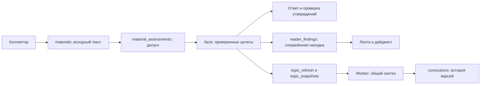

# Skin Research Intelligence

Адаптация https://github.com/vasilievyakov/desk-research-ai-public под исследования косметологии и ухода. Исходный checkout сохранён в `upstream/` для сравнения; рабочее приложение находится в корне. Локальные PRD и реестр источников сохранены.

## Что реализовано

- Независимые каналы Exa, DermNet, AAD и Cochrane; API/RSS-мониторинг и ручной ввод текста, ссылки, PDF. Настройки — `sources.json`. Сложных парсеров нет.
- PostgreSQL: документы, происхождение, DOI/PMID, цитируемые факты, история выводов/исправлений, ответы, ежедневные выпуски и доставка каждому получателю.
- Единый профиль читательниц около 40 лет: домашний уход, процедуры лица/шеи, домашние устройства/массаж и независимые данные о готовой косметике. Возраст не является жёсткой границей применимости исследования.
- Модель: ограниченная оценка допуска до глубокого извлечения, проверка цитат кодом и отдельным вызовом модели. Общие темы обновляет существующий worker. Старые факты при переработке сохраняются для истории.
- Ответы с номерами фактов и источниками, дополнительный поиск при недостатке данных, ограничения и уточнения. Персональные назначения исключены инструкциями и проверкой ответа; это не медицинская экспертная система.
- Основной интерфейс — Telegram: ежедневные выпуски и вопросы к базе знаний в личном чате. Доступ ограничен списком разрешённых чатов.
- Mini App обслуживается `web` в стандартном Compose: лента проверенных находок, свёрнутая личная история только во вкладке вопроса, личные закладки. Первоначально 10 находок/5 вопросов, продолжение кнопкой. Парольная веб-панель остаётся инструментом администратора.
- Ежедневный дайджест использует те же сохранённые находки с фактами, что и лента. Готовность общего тематического синтеза не является условием ответа или выпуска. Неподходящие пункты отбрасываются независимо; сбой и бюджетная блокировка не выдаются за отсутствие обновлений.

## Путь данных и текущая спецификация

Локальная реализация по [утверждённой SPEC](docs/specs/005-reader-relevance/approved-spec.md), [плану](docs/specs/005-reader-relevance/plan.md) и [задачам](docs/specs/005-reader-relevance/tasks.md) находится в ветке `reader-relevance-20261109` от `56f9ed7`, в `C:/Users/asus/Projects/Cosm2-sources-approved`. Старые незавершённые изменения соседней Cosm2 не переносились. Публикация и применение на сервере требуют отдельной команды.



Профиль и причины решений — `reader_profile.json`/`relevance.py`; тематический допуск отделён от `materials.status`. Актуальность проверяется по версии профиля, исходного текста и области. Личный допуск привязан к владельцу/исходному вопросу и не разрешает общую публикацию. Старые материалы без нового допуска хранятся, но не входят в общую выдачу. Точечный пересмотр ограничен 8 кандидатами за проход/вопрос; уже проверенные старые факты могут получить личный допуск без повторного извлечения.

Вопрос сначала читает подходящие действующие факты. Служебные слова не выбирают основания; предмет, синонимы и конкретная задача учитываются отдельно. При достаточных фактах нет нового поиска/разбора; после достижения достаточности остальные документы не разбираются. Ответ проверяется по утверждениям: допускается самостоятельно подтверждённая часть. Неверный формат проверяющей модели, неподтверждённые утверждения, пустое воздержание, техническая ошибка и исчерпанный бюджет различаются; безопасная диагностика содержит номера материалов/фактов.

Факты и отметки общих тем фиксируются атомарно. Worker объединяет изменения; перед публикацией вывода повторно проверяет снимок. На неизменный неуспешный снимок максимум 3 оплачиваемые автоматические попытки с паузой не меньше 15 минут; перезапуск и возврат A→B→A не обнуляют счётчик. Блокировка до вызова не расходует попытку. Ошибка общего синтеза не отменяет готовый ответ или сохранённые факты.

`reader_findings` хранит заголовок до 160 знаков, пояснение до 400, ограничение, ссылки и точные fact_ids вместе с версиями текста/профиля/фактов/редакции. Подготовка максимум 10 кандидатов за цикл, генерация и проверка отдельных пунктов; GET ничего не генерирует. Неуспешная находка удерживается без автоматической повторной оплаты до изменения входа/отдельного пересмотра; запрет бюджета или ошибочная конфигурация до вызова не блокируют восстановление. Старые собственные закладки доступны с пометкой и первоисточником без непроверенного пересказа.

`official_safety` определяется только для точных официальных FDA URL предупреждений/отзывов. Такая запись не требует клинического испытания, но требует тематического допуска и цитат; произвольный role/kind и отдельные MAUDE/device-event сообщения этого исключения не получают. Новые каналы мониторинга этим изменением не подключаются.

## Источники и границы проверки

| Канал | Доступные материалы | Фактическая граница |
|---|---|---|
| Exa Search/Contents | Поиск исходных публикаций и получение текста | Самостоятельный канал, выключенный без разрешённых настроек. Сниппеты и highlights не считаются прочитанным текстом; ссылки и авторство принадлежат публикациям. |
| DermNet | Дерматологическая справка | Ограниченный каталог: страница о topical retinoids. |
| AAD | Профессиональное объяснение для пациентов | Ограниченный каталог: публичная страница retinoid/retinol; это не формальная клиническая рекомендация. |
| Cochrane | Публичное резюме обзора | Ограниченный каталог: выбранная страница о вмешательствах при акне; это не полный обзор и не подтверждение покрытия ретинола или Fotona. |

Три прямые страницы работают независимо от Exa, без автоматической замены им недоступного подключения. Доступ и пригодность текста из Coolify ещё требуют живой приёмки. Для DermNet ранее получено только первичное подтверждение тематического маркера из worker. Локальное чтение с ноутбука остановила DNS-защита до HTTP; её не обходили. Полнота поиска по сайтам и покрытие Fotona не подтверждены.

Europe PMC/PubMed выключены в новом пути, включая прежние активные настройки БД; их материалы и история сохранены. Остальной прежний мониторинг сохраняет собственные настройки. Научный вопрос не отправляется в device/event или каталог товаров. Составы продуктов и отдельные сообщения об инцидентах не становятся доказательством эффективности или основанием пункта сводки.

Ответ и история различают готовый, частичный ответ, недостаток проверенных данных, технический сбой и необходимое уточнение. Нет текста — нет глубокого анализа. Ошибка одного материала не теряет проверенные факты остальных. AAD/Cochrane откладываются, если выбранные страницы не удалось прочитать; доступные каналы продолжают работу. Частично доступное подключение сохраняется с ограничением. Явное сохранение источника администратором с `active=true` разрешает повторную проверку отложенного подключения.

Worker выполняет один суточный поиск Exa по очереди: взрослый уход за лицом/шеей; процедуры и домашние устройства; независимые данные о готовой косметике. День определяется `DIGEST_TIMEZONE`; отметка сохраняется до HTTP. После сбоя или перезапуска второй суточной попытки нет, вопросы пользователя её отметку не меняют. Время и получатели выпуска сохраняются. «Подходящих обновлений нет» допустимо только после завершённой проверки согласованного объёма; незавершённая проверка и частичный выпуск имеют собственные статусы.

## Локальный запуск

Python 3.12+ и PostgreSQL. В PowerShell:

```powershell
python -m venv .venv
.\.venv\Scripts\python.exe -m pip install -r requirements.txt
Copy-Item .env.example .env
```

Для прямого запуска Python задайте DATABASE_URL, OPENROUTER_API_KEY, MODEL, лимит модели, TELEGRAM_TOKEN и TELEGRAM_CHAT_IDS. `.env` не загружается автоматически при запуске Python: задайте переменные окружения сервиса. Для обычного локального Compose заполните SERVICE_PASSWORD_POSTGRES в `.env`; Coolify создаёт этот пароль автоматически. Не публикуйте ключи и пароли.

```powershell
.\.venv\Scripts\python.exe main.py worker
# В другом терминале с тем же окружением:
.\.venv\Scripts\python.exe main.py bot
```

Бот получает сообщения через Telegram long polling и может работать без домена. Для Mini App сервису `web` нужен HTTPS-домен на внутреннем порту 8000 и `OWNER_TELEGRAM_ID`; `WEBAPP_URL` переопределяет адрес при необходимости. Отдельный `docker-compose.web.yml` включает пароли старой админ-панели — SERVICE_PASSWORD_APP и SERVICE_PASSWORD_ADMIN.

`python main.py collector` делает один проход; worker сам запускает сбор по расписанию источников, обработку и проверяет ежедневный выпуск. Час выпуска задаёт DIGEST_HOUR (по умолчанию 19), часовой пояс DIGEST_TIMEZONE (Europe/Moscow). Это стартовые настройки, а не ранее согласованное пользователем время.

`python main.py bot` отвечает на вопросы и отправляет подготовленные выпуски в Telegram. TELEGRAM_TOKEN выдаёт @BotFather. После запуска напишите своему боту `/id`, затем укажите полученное число в TELEGRAM_CHAT_IDS в Coolify. Для подруг добавляйте их числа через запятую; каждая должна сначала открыть бота. Команды `/start`, `/help`, `/status`, `/digest` и обычные вопросы доступны разрешённым чатам. `/id` возвращает только номер собственного личного чата и не открывает доступ к данным. Не запускайте этот сервис, пока не готовы к реальной отправке.

Если приходят только сообщения об ожидании анализа, отправьте `/status`: бот покажет числа материалов, незаданные настройки модели и безопасные причины ошибок, не значения ключей. Без MODEL, OPENROUTER_API_KEY и положительного MODEL_MONTHLY_USD анализ приостанавливается, не расходуя попытки документов. После исправления настроек пустой сегодняшний выпуск обновится при появлении результатов и будет доставлен новой ревизией. Для обычного мониторинга ошибки источников дают паузу до часа; суточный поиск Exa и отложенные подключения имеют отдельные правила выше.

Основной запуск: `docker compose up --build` (postgres, worker, bot, web). Необязательная локальная панель: `docker compose -f docker-compose.yml -f docker-compose.web.yml -f docker-compose.local.yml up --build`. Она публикуется только на localhost; при занятом порте задайте LOCAL_WEB_PORT. В Coolify используйте основной docker-compose.yml; старая парольная панель не обязательна для Mini App. Секреты и данные БД не входят в образ.

## Развёртывание в Coolify

Используйте Docker Compose из Git-репозитория, файл `/docker-compose.yml`. Локальный `.env` на сервер копировать не требуется: переменные явно объявлены в `environment` каждого сервиса.

Coolify автоматически создаёт и сохраняет SERVICE_PASSWORD_POSTGRES. Ручной ввод пароля БД не требуется. Один пароль используется контейнерами postgres, worker, bot и web. Пароли старой админ-панели для Telegram/Mini App не нужны.

Для анализа задайте OPENROUTER_API_KEY, MODEL и лимит MODEL_MONTHLY_USD; для рассылки — TELEGRAM_TOKEN и TELEGRAM_CHAT_IDS. Значения MODEL_CALL_RESERVE_USD, DIGEST_TIMEZONE и DIGEST_HOUR уже имеют начальные настройки. Эти внешние ключи приложение использует во время работы, их не нужно включать в сборку образа. При MODEL_MONTHLY_USD=0 платный анализ отключён. DATABASE_URL для контейнеров уже формируется в Compose из автоматически созданного пароля postgres; вручную задавать адрес БД не нужно.

После отдельного согласования деплоя изменения переменных применяются через Redeploy. Для Telegram-бота домен не требуется. Реальный деплой проверяется в Coolify; локальный `compose config` проверяет только конфигурацию, без сборки и запуска контейнеров. Текущая работа не подтверждает выполнение деплоя.

Если PostgreSQL уже был успешно инициализирован со старым вручную заданным паролем, сохраните это же значение в SERVICE_PASSWORD_POSTGRES: смена переменной окружения не меняет пароль существующей базы. При первом запуске ничего переносить не требуется.

## Расходы и ограничения

Для согласованного включения Exa задайте значения в Environment Variables Coolify; это настройки, не команда терминала:

| Переменная | Значение |
|---|---|
| `EXA_API_KEY` | Секретный ключ приложения; только в Coolify, не ключ MCP агента |
| `EXA_MONTHLY_USD` | `5` |
| `EXA_SCOPE_USD` | `0.05` |
| `EXA_SEARCH_UPPER_USD` | `0.007` |
| `EXA_CONTENTS_UPPER_USD` | `0.003` |
| `EXA_MAX_RESULTS` | `5` |
| `EXA_MAX_CONTENTS` | `3` |
| `EXA_PRICING_DATE` | `2026-11-08` |

Тариф проверен по [официальной документации Exa](https://exa.ai/docs/reference/pricing): используются только Search `auto` и Contents с текстом, без summary/highlights. Указанные верхние суммы относятся к целым вызовам. Подтверждение тарифа в этой версии действует по 9 декабря 2026 включительно (UTC); затем поиск блокируется до повторной проверки тарифа и обновления подтверждённой версии кода. Смена одной даты в окружении не заменяет проверку.

По умолчанию денежные настройки равны нулю. Общий предел Exa — $5 в месяц, не более $0,05 на вопрос или суточный запуск, включая Contents и повторы. Превышение настройки не повышает эти пределы. До HTTP резервируются расходы с учётом параллельных запросов; неизвестная стоимость сохраняет резерв. Месячный ноль означает плановое выключение Exa; положительный бюджет с неполной настройкой — незавершённую проверку этого канала. Остальные источники продолжают работу. Совпадающие исходные вопросы одного владельца консервативно используют общий разовый бюджет в пределах месяца; полноценная защита первого POST от повторов не добавлялась.

MODEL_MONTHLY_USD=0 по умолчанию блокирует платные вызовы. Установите собственный USD-лимит после вычета инфраструктуры и поиска из общего бюджета 5000 ₽. Каждый запрос независимо резервирует MODEL_CALL_RESERVE_USD; возврат транзакции обработки не отменяет запись расхода. После ответа OpenRouter резерв заменяется фактической стоимостью в расчёте доступного бюджета. Если стоимость неизвестна (например, запрос оборвался), резерв сохраняется. Резерв должен покрывать выбранную модель и контекст; это не гарантия цены провайдера. Дополнительно задайте денежный лимит у провайдера.

Готовые оценки источников и ограничения сохраняются; собственные проценты/баллы доказательности не рассчитываются. Проверка моделью и совпадение цитаты снижают риск ошибок, но не доказывают корректность медицинского вывода.

MFDS требует регистрации и настройки разрешённого endpoint; CosmeticsDesign Europe/Asia и Google News ждут проверки доступа. Open Beauty Facts не гарантирует покрытие конкретного крема. Исторический поиск задаётся запросами источников; полного обхода всех страниц архива пока нет. Если продукт нельзя найти или однозначно определить, система должна сообщать о недостатке данных, а не придумывать состав.

Миграция схемы добавляет поля/таблицы без удаления прежних данных. Старые AI-источники отключаются; их материалы сохраняются. Перед подключением существующей производственной БД сделайте резервную копию и проверьте миграцию на копии.

Длинные ответы и дайджесты разбиваются на сообщения Telegram без ссылки на веб-интерфейс. Прогресс доставки сохраняется в БД. После обрыва сети между приёмом Telegram и фиксацией БД возможен повтор (API не гарантирует exactly-once). Неуспешные получатели повторяются независимо.

## Проверки разработчика на отдельной БД

Тесты используют подменённые HTTP, модель и Telegram. PostgreSQL-проверки работают только с отдельной `TEST_DATABASE_URL`; без неё пропускаются и не считаются пройденными. В текущей изолированной рабочей копии C использует уже подготовленную `skin_sources_approved_test`, а не рабочую БД или прежнюю `skin_research_test`. Общий интерпретатор и переносная PostgreSQL берутся из исходной папки; код тестируется из новой рабочей копии:

```powershell
Set-Location C:/Users/asus/Projects/Cosm2-sources-approved
$env:PATH = 'C:/Users/asus/Projects/Cosm2/.local-postgres/pgsql/bin;' + $env:PATH
$env:PYTHONPATH = 'C:/Users/asus/Projects/Cosm2/downloads/psycopg-source/psycopg'
$env:PSYCOPG_IMPL = 'python'
$env:OWNER_TELEGRAM_ID = '999001' # Только тестовая фикстура
$env:TEST_DATABASE_URL = 'postgresql://skin_test@127.0.0.1:55432/skin_sources_approved_test?connect_timeout=5'
$env:DATABASE_URL = $env:TEST_DATABASE_URL
& 'C:/Users/asus/Projects/Cosm2/.venv/Scripts/python.exe' -X utf8 -m unittest discover -s tests -v
& 'C:/Users/asus/Projects/Cosm2/.venv/Scripts/python.exe' -X utf8 -m unittest web.test_web -v
node --test tests/test_miniapp.js tests/test_miniapp_browser.js
& 'C:/Users/asus/Projects/Cosm2/.venv/Scripts/python.exe' -B -X utf8 -c "from pathlib import Path; paths=[Path(p) for p in ('main.py','net.py','llm.py','evidence.py','relevance.py','research.py','digest.py')]+[p for d in ('db','collector','worker','web','bot') for p in Path(d).glob('*.py')]; [compile(p.read_text(encoding='utf-8'),str(p),'exec') for p in paths]"
```

Для browser-теста нужны Node с WebSocket и локальный Chrome (`CHROME_PATH` позволяет переопределить путь); реальные HTML/CSS/JS проверяются на ширине 375 px, Telegram/HTTP перехвачены. Временные профили и снимки остаются в игнорируемой `_temp/`. SHA утверждённой SPEC проверяется по исходным байтам рабочей копии и Git index; `.gitattributes` сохраняет её без нормализации переносов. C также компилирует 20 модулей через `compile()` без записи pyc и проверяет staged diff.

Результаты независимых прогонов и коммиты — `progress.md`. Автономные проверки и реальная тестовая PostgreSQL не подтверждают прямой доступ из Coolify, качество ответа живой модели или завершение всей приёмки PRD. Во время этой реализации платные запросы приложения и реальная отправка Telegram не выполнялись.

## Живая приёмка после отдельно согласованного деплоя

Ручные команды терминала для этой проверки не нужны. Агент готовит проверку через приложение и доступные журналы Coolify; пользователь проверяет русский результат в Telegram/Mini App.

1. Проверить один свежий выпуск и вопросы «расскажи про ретинол» и «что помогает от пигментных пятен?». В выпуске нет посторонних тем; находка соответствует первоисточнику, видны исходный год/тип/ограничение. По вопросу есть обоснованный ответ либо конкретная нехватка данных/ошибка. Дополнительно проверить широкий вопрос об эффективности Fotona без обязательного уточнения известного предмета.
2. Для Cochrane отдельно проверить выбранную страницу о вмешательствах при акне. Получение её текста не считать доказательством покрытия ретинола или Fotona.
3. Проверить статусы источников и сохранённого ответа в истории. Если AAD/Cochrane не читаются, должно быть видно отложенное подключение; остальные каналы продолжают работу, автоматической подмены через Exa нет. Сбой или пустой результат не сопровождаются «Ответ готов».
4. В доступных журналах/статусах Coolify проверить безопасные этап/код/номера материалов и фактов, а также один суточный запуск. Ключи не пересылать. При недоступном тексте, исчерпанном лимите или незавершённой обработке сводка показывает неполноту, а не отсутствие обновлений. В Mini App история только во «Вопросе», сначала свёрнута; лента не содержит старые пересказы/ожидающие допуска материалы. Получение сообщения само по себе не подтверждает качество содержания.

Эта живая приёмка пока не выполнена. Не увеличивать денежные пределы и не подключать замену недоступного источника без отдельного решения.
